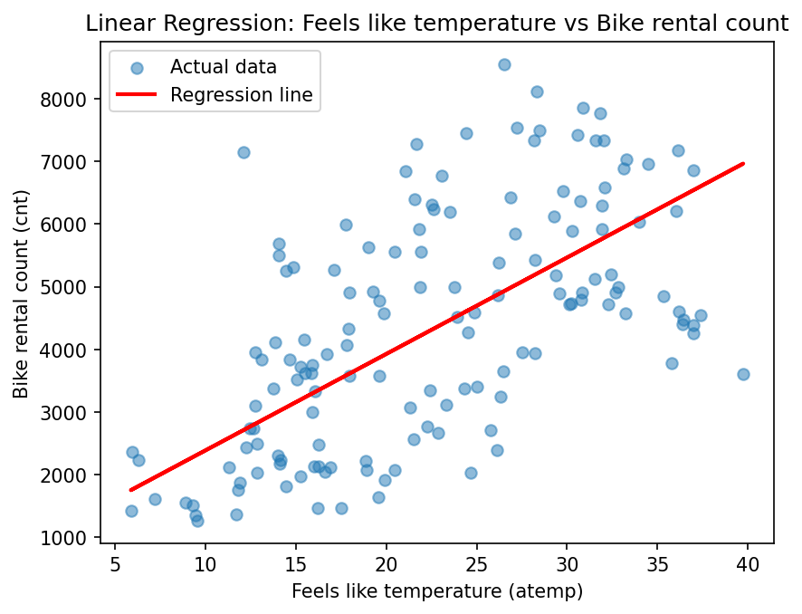

# BikeRentalPrediction

Simple Linear Regression project for the CodeOrbit Tech Data Science Internship (Task 3).
The goal is to predict the number of daily bike rentals from the feels-like temperature.

## Dataset
`day.csv`: daily bike rental data for 2018–2019 (date, season, weather, temperature,
humidity, wind speed and number of rentals).

## Steps
1. Loaded the data with pandas
2. Cleaned the data (empty rows, duplicates, unused columns, wrong values, data types)
3. Chose `atemp` as the input variable (highest correlation with `cnt`: 0.63)
4. Split the data into 80% train / 20% test
5. Trained a Linear Regression model with scikit-learn
6. Evaluated the model and plotted the regression line

## Results
- Every +1°C of feels-like temperature adds about **154 rentals** per day
- **R² = 0.35**: temperature explains about 35% of the changes in rentals
- **RMSE ≈ 1,500 bikes** (the average day has about 4,500 rentals)

Temperature has a clear positive effect, but other factors (weather, year, season)
are needed for more accurate predictions.

## How to run
Requirements: Python 3, pandas, numpy, matplotlib, scikit-learn

Open `linear_regression.ipynb` in Jupyter or VS Code and click **Run All**.
